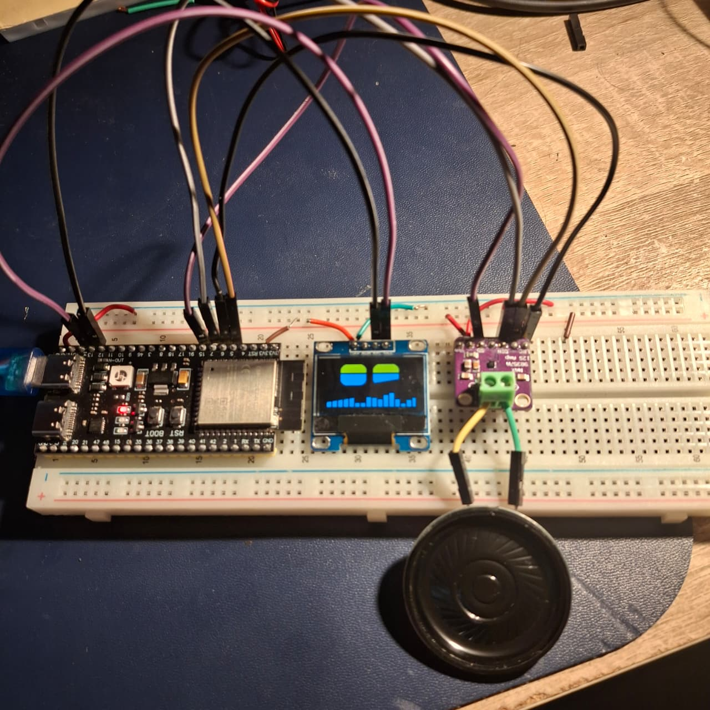

# ESPeak Hub

A small AI voice speaker built on an **ESP32-S3**. You talk to a phone app; a serverless backend turns your speech into an answer; the answer is spoken by the ESP32 through a MAX98357A amplifier and a 3 W speaker. A character called **Dess** lives on a 0.96" OLED as a pair of animated eyes that show what the speaker is doing (listening, thinking, speaking) and its mood.

Built as the final project for an RTOS course. The main engineering question was: *how should the ESP32's FreeRTOS tasks be organised so that the first sound starts as early as possible without the audio ever stuttering?* The benchmark, data and figures are in [`bench/`](bench/).

<p>
  
  
</p>

## How it works

```
 phone app --audio--> Cloudflare Worker --> Groq: Whisper STT -> LLM (JSON: mood + text) -> Orpheus TTS
                           |                                     (Korean: Workers AI MeloTTS)
                    Durable Object  (one per speaker, holds the WebSocket)
                           |   wss: JSON state messages + binary PCM frames (8 KB each)
                           v
                 ESP32-S3 --> I2S --> MAX98357A amp --> speaker
                    |
                  SSD1306 OLED: Dess's face
```

The ESP32 never talks to an AI service. It is a thin client holding one WebSocket to the Worker, so API keys never touch the board.

| Folder | What is in it |
|---|---|
| [`firmware/`](firmware/) | PlatformIO project (Arduino framework, ESP32-S3). `src/speaker.cpp` is the firmware; the other `src/*.cpp` are the bring-up steps (tone, OLED, PSRAM, Wi-Fi). Envs `bench-v0..v4` build the benchmark variants. |
| [`firmware_arduino/`](firmware_arduino/) | The same firmware (variant V4) reorganised into tabs for the Arduino IDE. Start with its README. |
| [`backend/hello-worker/`](backend/hello-worker/) | Cloudflare Worker + `Speaker` Durable Object (JavaScript). Includes test scripts. |
| [`app/`](app/) | Flutter app (Android): hold-to-talk, chat history, phone/speaker switch, EN / Buddy / 한국어 modes, Dess's face. |
| [`bench/`](bench/) | RTOS benchmark: method, driver scripts, raw data, statistics, figures, draft report section. |
| [`report/`](report/) | Project report (docx) and the script that builds it. |
| [`data/`](data/) | Latency measurements of the AI pipeline. |

## Hardware

| Part | Notes |
|---|---|
| ESP32-S3 board | 8 MB PSRAM (octal), USB-UART |
| MAX98357A I2S amplifier | BCLK GPIO5, LRC GPIO6, DIN GPIO7, SD GPIO15 (LOW = muted) |
| 3 W / 8 Ω speaker | |
| SSD1306 128x64 I2C OLED | SDA GPIO14, SCL GPIO13, address 0x3C |

Pins are `#define`s at the top of the firmware if your wiring differs.

## Setup

You need your own accounts and keys; nothing secret is in this repository.

### 1. Backend (Cloudflare Worker)

```bash
cd backend/hello-worker
npm install
npx wrangler secret put GROQ_API_KEY   # from console.groq.com
npx wrangler secret put APP_KEY        # any long random string; the app and board send it as X-App-Key
npx wrangler deploy
```

Optional: `GEMINI_API_KEY` enables the Gemini provider. The Worker uses the Workers AI binding (`ai` in `wrangler.jsonc`) for Korean speech. For local runs put the keys in `.dev.vars` (git-ignored).

### 2. Firmware

Copy `firmware/src/secrets.h.example` to `secrets.h` (or `firmware_arduino/speaker/secrets.h.example`) and fill in your Wi-Fi name and password, the Worker host and the same `APP_KEY`. Then either open `firmware_arduino/speaker/speaker.ino` in the Arduino IDE (variant V4, the recommended one), or use PlatformIO:

```bash
cd firmware
pio run -e speaker --target upload --upload-port <your COM port>   # baseline V0; bench-v4 = optimized
```

### 3. App

Copy `app/env.json.example` to `app/env.json` and fill it in, then:

```bash
cd app
flutter run --dart-define-from-file=env.json
```

`env.json` is baked into the build, so do not share an APK built from it.

## Benchmark result in one paragraph

Buffering the whole reply before playing (V0) delays the first sound by 0.7 / 1.3 / 4.4 s for a 2 / 4 / 13 s reply, because the Wi-Fi download is only about 3x faster than real time. Streaming through a FreeRTOS `StreamBuffer` with a 250 ms prebuffer (V1) starts playback after about 145 ms regardless of reply length. Making the Arduino `loop()` yield and blocking the I2S writes (V4) then cut core-1 playback load from about 93 % to about 15 %. Full method, statistics and caveats: [`bench/README.md`](bench/README.md) and [`bench/REPORT_section.md`](bench/REPORT_section.md).

## Status and limitations

- Works end to end on hardware (phone to speaker, three language modes, mood faces).
- No microphone on the ESP32 yet; speech is captured on the phone.
- The WebSocket uses `wss` without certificate pinning.
- The OLED is a dual-colour module (top 16 rows yellow, rest blue).

## License

[MIT](LICENSE)
